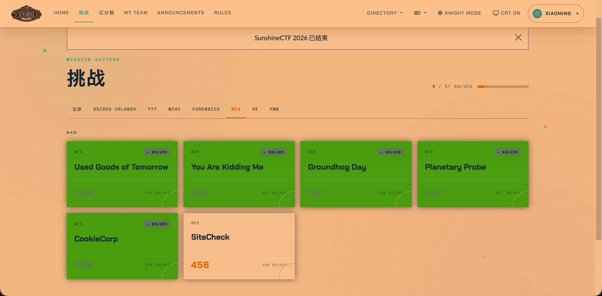
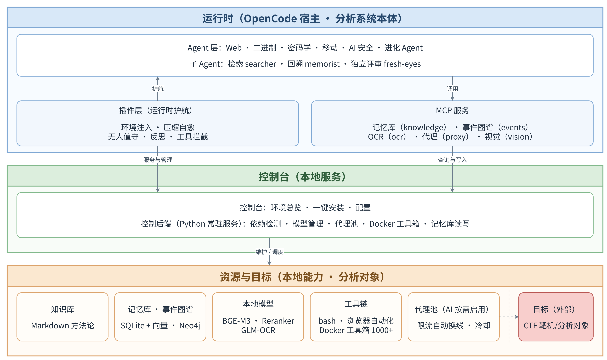
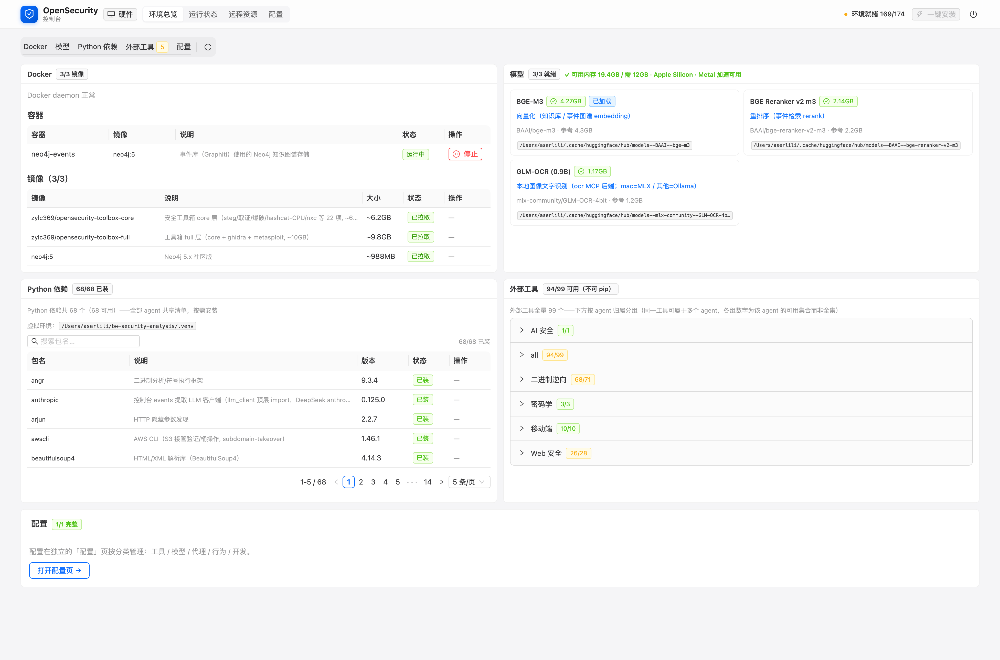

# OpenSecurity

> **中文** | [English](README.en.md)

> AI 驱动的多领域安全分析 Agent 平台：让 LLM 真正像一个研究员团队那样工作；2.0 起，长任务无人值守、自己跑到终点。

[](LICENSE)

## 这是什么

OpenSecurity 让 LLM 端到端地完成一次安全分析：拿到一个目标（文件、源码或 URL），自己编排工具链（IDA Pro、Frida、apktool、浏览器……），一步步推进，最后产出一份可验证的报告。不是问一句答一句，不是停在"我建议你用 IDA 看看"，而是真的把工具跑起来、读输出、做推理、再决定下一步。

覆盖五个安全分析领域 + 一个自我进化引擎：

| Agent | 负责什么 |
|-------|---------|
| `binary-analysis` | 二进制逆向：算法还原、壳检测、漏洞挖掘 |
| `mobile-analysis` | 移动端逆向：APK/IPA 反编译与 Java/Native 分析 |
| `web-analysis` | Web 安全：URL/源码的漏洞审计与攻击链构造 |
| `ai-security-analysis` | AI 应用安全：LLM 应用的提示注入与越狱 |
| `crypto-analysis` | 密码学攻击：RSA/格/ECC/古典/对称/哈希 |
| `security-analysis-evolve` | 自我进化：从实战复盘中沉淀脚本与知识库 |

另有 4 个辅助 Agent，由主 Agent 按需派发：`searcher`（外部情报检索）、`knowledge-scout`（外部 writeup 侦察与素材收集）、`memorist`（历史记忆检索）、`fresh-eyes`（独立反思评审）。

## 实战记录：SunshineCTF 2026

> 完整拆解见 [无人值守完成 CTF 挑战：2.0 实战记录](docs/项目介绍/2.0-实战博文/01-无人值守完成CTF挑战.md)

**系统在 SunshineCTF 2026 上解出一批 CTF 题（全部 Web 方向），从启动到交出答案全程无人值守。** 不是演示，是真实赛题上的战绩：系统负责解题，人只负责两件事——给题，和提交。

**图 1：Web 题区（标记 SOLVED 的题目均由本系统完成）：**



| 题目 | 打法 |
|------|------|
| Used Goods of Tomorrow | 2 分钟拿下：未授权接口泄露高权限凭证，零元购 flag |
| You Are Kidding Me | JWT 的 kid 头注入，签名密钥可被指定，伪造管理员凭证 |
| Groundhog Day | gopher 协议 SSRF，直通服务端渲染链读文件 |
| CookieCorp | Cookie Jar 溢出，把管理员机器人浏览器里的身份"挤"出去 |
| Planetary Probe | 单比特盲注起步，一路打到数据库命令执行 |
| SiteCheck（456 分） | SSRF 硬仗，机制用到最满的一道（见下） |

**SiteCheck** 是把 2.0 机制用到最满的一道："提交 URL、无人机访问并截图"的 SSRF 题，跨约 32 小时破局、赛后判题通过（Correct）。攻击链四步：过滤器拦掉 IPv4 环回字面量但放行 IPv6 `[::1]` → 无人机自带的管理员会话只绑定在 `[::1]` → URL 锚点把 1400 像素空白之后的受限区滚进 800 像素高的截图视口 → 本地 OCR 从回传截图读出 flag（两次识别 + 直读，三方交叉验证）。破局一击由**无人值守**完成：空闲时注入"未完成就继续"的恢复消息，137 秒后 flag 到手；期间**反思** 4 次触发校准方向、**代理** 16 次自动换线顶住限流，**记忆库**开局即命中一条 SSRF 过滤绕过变体全集（`[::1]` 就在清单里），收官时解法由 Agent 自主落库。

## 核心机制

1.0 会做分析；2.0 让它独立把任务做完。长任务的敌人是**停**（等人点击、被限流掐断）、**偏**（在死路上加速）与**忘**（这次学到的经验下次用不上），下面这组机制分别对付它们：

1. **无人值守**：空闲即检查"完成标记"；没有标记，就注入"未完成就继续做"的恢复消息。标记每次随机生成，模型没法"假装完成"。几十小时级的任务，没人盯着也能推进。
2. **反思**：按活跃时长定期触发（默认 30 分钟，控制台可调）；触发时附上运行数据（已运行多久、期间多少次工具调用），提醒先落盘实验结果、再做方向盘点（继续 / 换向 / 放弃 / 深挖）。忙碌时附在命令输出之后，空闲时发唤醒消息。防止在死路上闷头加速。
3. **知识库**：按方向组织的方法论文库，写明"什么场景、用什么打法、具体命令、怎么判断成败"。慢资产：不自动生长，每次更新来自复盘后的提炼。让系统面对陌生题目时，先查手册再动手。
4. **记忆库**：实时可查（开工先检索过往经验）、全程留痕（每步工具调用与结果按任务写入，支持压缩恢复与事后复盘）、自动进化（分析 Agent 自主判断并沉淀可复用解法，越用越厚）。
5. **权限超时自动拒绝**：权限询问超时自动拒绝（默认 60 秒、默认仅对 external_directory 类型生效，均可配置），并把引导反馈交给模型自行改道。任务不卡在"等人点击"。
6. **代理模块**：批量扫描、验证这类"大轰炸"被限流时自动换线；被限流的地址冷却一段时间。任务不因限流、封锁而中断。
7. **本地模型**：BGE-M3（向量化）、Reranker（重排序）、GLM-OCR（图像文字）三个模型本地运行（合计约 7.6GB）；也可卸载到另一台机器做远程推理节点——局域网直连，或异地经 P2P 隧道访问（无需公网 IP、不暴露端口）。省钱，数据不出门。
8. **控制台**：随服务端一起启动；环境总览（缺什么一键装）与配置管理（工具 / 模型 / 代理 / 行为）一屏搞定。

> 这就是我想要的状态：**你去睡觉，它继续干活。**

## 核心架构

**三层分离**：
- **AI 编排层**：Agent prompt（何时调用什么工具、如何推理），由 LLM 执行
- **工具层**：Python / Bash 脚本（query.py、update.py、initial_analysis.py……），工程师维护
- **知识库层**：按需加载的 Markdown（壳处理策略、Unicorn 模板、Frida 速查……），evolve Agent 持续沉淀

关键决策：**LLM 不直接操作 GUI**。所有 IDA 操作走 `idat -A -S<script>` headless 模式 + IDAPython 脚本，确保分析过程可稳定复现。

**图 2：系统架构。运行时（OpenCode 宿主）调用控制台（本地服务），控制台依赖资源与目标（本地能力 · 分析对象）：**



一句话说明：运行时（分析系统本体）把任务做出来，控制台把环境备好，资源与目标提供两者使用的本地能力（知识 / 记忆 / 模型 / 工具 / 出口）。

**一次任务里的协作：**

```
  人：切换最合适的Agent
    │
    ▼
  人：给题
    │
    ▼
  分析 Agent（Web / 二进制 / 密码 / 移动 / AI 安全）
    │
    ├──▶ 工具链（bash / 浏览器 / 1000+ 工具）
    │      └─ 出口默认直连；大轰炸时由 AI 切到代理模块（限流自动换线）
    │
    ├──▶ 知识库 + 记忆库（MCP 实时查询 / 自动沉淀）──▶ 本地模型（向量化 / 重排序 / OCR）
    │
    └──▶ 插件层（运行时护航）：无人值守（防停）+ 反思（定期盘点）
    │
    ▼
  答案（flag）──▶ 人：提交
```

一句话读懂：**人只出现在两端**。分析 Agent 负责干活；插件层全程护航——停下了就推回去（无人值守），跑久了就提醒盘点（反思）。

## 版本状态：2.0（硬件要求与获取）

当前 `master` 为 1.0。2.0 已完成开发并经过实战验证（见上方[实战记录](#实战记录sunshinectf-2026)，完整拆解见[无人值守完成 CTF 挑战：2.0 实战记录](./docs/项目介绍/2.0-实战博文/01-无人值守完成CTF挑战.md)），但**尚未合并到 master**，因为 2.0 对硬件有要求；后续会把它合并进 master。

2.0 的硬件要求（测试机：MacBook Pro / M4 Pro / 48GB）：

| 项 | 占用 |
|---|---|
| 操作系统与基础软件 | ~8GB |
| 本地模型 ×3（BGE-M3 / Reranker / GLM-OCR） | 加载需预留 ~12GB（合计约 7.6GB） |
| Docker + Neo4j | ~2GB |
| 主服务 + 控制台 | ~3GB |
| 分析任务余量 | 8GB+ |

**建议内存 32GB 起步、48GB 更从容**；磁盘另需 25GB+（工具镜像与模型缓存）。硬件不足时，可把模型卸载到另一台机器做远程推理节点——局域网直连，或异地经 P2P 隧道访问（无需公网 IP、不暴露端口，见 [远程节点部署](.opencode/control/backend/tools/relay-deploy/README.md)）。

硬件符合要求 → 拉取 [**Tag ≥ 2.0**](https://github.com/zylc369/OpenSecurity/releases/tag/2.0) 的版本；否则请继续使用 master（1.0）。

## 快速上手

### 前置依赖

| 依赖 | 版本 | 说明 |
|------|------|------|
| [OpenCode](https://github.com/anomalyco/opencode) | 1.x | AI Agent 框架，本平台构建于其上（插件暂不适配 2.x，待其稳定几个版本后支持） |
| Python | 3.8+ | 工具脚本运行时（Plugin 自动创建 venv） |
| IDA Pro | 7.6+ | 二进制逆向必需（仅 `binary-analysis` / `mobile-analysis` 需要） |
| C/C++ 编译器 | 任意 | 计算密集型任务用（macOS: clang / Linux: gcc / Windows: VS Build Tools） |

移动端 / Web / AI 安全分析还需对应工具（Frida、apktool、jadx、Playwright……）。每条消息发送前，插件会自动检测环境：自举层（Python 环境与依赖）缺失时提示运行 `install.sh`；通过后由控制台做全分类检测（Python 包 / 外部工具 / 编译器 / Docker / 模型五分类），缺必需依赖时拦截对话并给出控制台链接，在控制台一键安装。

**图 3：控制台首页。Docker、模型、Python 依赖、外部工具的就绪状态一屏可见，缺什么一键安装：**



### 安装

```bash
# 1. 克隆仓库（含 submodule，首次推荐）
git clone --recursive https://github.com/zylc369/OpenSecurity.git
cd OpenSecurity

# 已克隆但漏了 submodule？补拉一次：
# git submodule update --init --recursive

# 3. 安装环境依赖（Python 依赖 + 外部工具；插件检测缺失时也会提示此入口）
bash .opencode/install.sh   # Windows 使用 install.ps1
```

> **关于 submodule**：`vendor/` 下包含 OpenCode、Frida、IDA SDK 等参考源码，方便查阅但不影响运行。磁盘紧张可以不加 `--recursive`，平台核心功能不依赖它们。

### 配置 IDA Pro

IDA Pro 路径通过 `IDA_PRO_HOME` 指定（IDA Pro 安装目录）。两种方式任选：

- 打开控制台（`http://localhost:5173/`，首次对话后自动启动），在配置页填写 `IDA_PRO_HOME`
- 或编辑 `$OPENCODE_ROOT/.ai_env`（控制台首次启动时创建带注释的模板）：

```ini
# $OPENCODE_ROOT/.ai_env
IDA_PRO_HOME=<IDA Pro 安装目录>
```

配置后插件的 shell 环境会注入 `$IDAT`（idat 完整路径），agent 直接调用。环境状态（Python 包 / 外部工具 / 编译器 / Docker / 模型）在控制台首页一屏可见。

### 第一次分析

```bash
# 在工作目录启动 OpenCode
cd ~/your-workspace
opencode
```

在 TUI 中切换到对应领域的 Agent，然后丢一句话：

```
帮我逆向 /Users/me/Downloads/crackme.exe，找出正确的 license
```

Agent 会自主完成：信息收集 → 分析规划 → 工具执行 → 结果验证 → 报告产出。中间产物持久化在 `~/bw-security-analysis/workspace/<task_id>/` 下，包括反编译输出、截图、求解脚本、最终报告。

### 使用建议

- **恢复模式（逃生舱）**：万一插件自身的 bug 把消息入口拦死（发什么都不放行），在消息开头加上 `>>>RECOVER-MODE<<<` 再发一条，就会跳过插件的全部拦截，把话直接送到 AI 面前（比如让它去修插件代码）。这是条零依赖通道：只认这个字符串前缀，不碰控制台、配置等任何可能坏掉的依赖。
- **先把知识库蒸馏进记忆库**：记忆库初始是空的，建议先让 AI 把知识库蒸馏成记忆库条目（对 AI 说一声即可），这样分析过程中的检索从一开始就有货可查。
- **遇到问题，先问 AI**：环境缺了、依赖坏了、脚本报错，直接丢给 AI 排查修复，比翻文档快。

### 常用斜杠命令

围绕一次分析任务的常用动作做成了斜杠命令，在会话里输入命令名即可调用：

| 命令 | 做什么 |
|------|--------|
| `/ctf-events` | CTFtime 赛事速览：进行中（按剩余时间排）与即将开始（按开赛时间排）两个表格，附带权重、链接、参赛限制等信息 |
| `/create-challenge-doc` | 把官网题目忠实落盘：生成本地分析文档 + 下载原始附件（不解压、不解读），不需要手动拷贝题目到本地 |
| `/knowledge-search` | 外部 writeup 侦察：与已有知识库做 gap 对照、评估价值、下载素材，产出"建议沉淀清单" |
| `/write-writeup` | 按固定规范生成教学式分析报告：前置知识、攻击链、完整复现、防御建议，分段写作防长文卡壳 |
| `/analysis-attribution` | 对已完成任务做机制贡献归因：架构机制（无人值守 / 反思 / 记忆库 / 子 agent……）与模型推理各占多少，附硬时序指标与"没有 / 错过"清单 |

## 数据与代码分离

| 类别 | 位置 | 是否提交 git |
|------|------|-------------|
| **代码** | `.opencode/` | 是 |
| **运行时数据** | `~/bw-security-analysis/` | 否（venv、config、workspace、logs） |
| **隐私配置** | `.privacy-data/` | 否（API Key 等） |

## 文档导航

| 文档 | 内容 |
|------|------|
| [项目深度介绍](docs/项目介绍/open-security-介绍.md) | 完整的设计理念、架构详解、反直觉决策 |
| [2.0 实战博文](docs/项目介绍/2.0-实战博文/01-无人值守完成CTF挑战.md) | 无人值守完成 CTF 挑战：2.0 实战记录 |
| [知识与记忆体系](docs/项目介绍/知识与记忆体系.md) | 知识库与记忆库的读写机制（三层记忆体系） |
| [新机器配置指南](docs/项目介绍/新机器配置指南.md) | 从零配置一台新机器（各 Agent 共用 Python 环境与工具链） |
| [远程节点部署](.opencode/control/backend/tools/relay-deploy/README.md) | remote-p2p：VPS 中继 + 打洞直连的远程推理节点部署（含手机朗读链路） |
| [如何添加新 Agent](docs/contributing/add-new-agent.md) | 扩展平台支持新的安全分析领域 |
| [Roadmap](docs/ROADMAP.md) | 项目路线图与待办方向 |
| [Plugin 开发实战](https://github.com/zylc369/OpenSecurity/blob/main/.opencode/binary-analysis/knowledge-base/opencode-plugin-development-guide.md) | OpenCode Plugin 工程实践 |
| [IDAPython 编码规范](https://github.com/zylc369/OpenSecurity/blob/main/.opencode/binary-analysis/knowledge-base/idapython-conventions.md) | 工具脚本开发规范 |
| [ai-dialogue 工具](docs/项目介绍/ai-dialogue.md) | 通用 AI 对话工具：通过 opencode serve 与目标模型对话 |

## 贡献

欢迎各种形式的贡献：新 Agent、新工具脚本、知识库补充、bug 修复、文档改进。

详见 [CONTRIBUTING.md](CONTRIBUTING.md)。

特别欢迎的方向（参见 [Roadmap](docs/ROADMAP.md)）：
- IPA 分析路径增强
- AI 安全攻击方法论沉淀
- Windows 内核驱动分析
- 更多框架的 Web 安全知识库

## License

[Apache-2.0](LICENSE)
